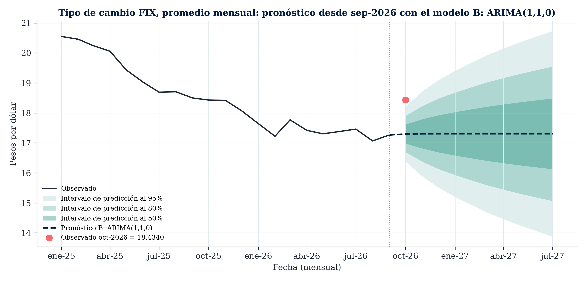
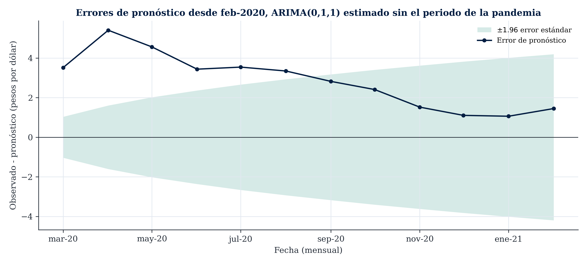

# ¿Era predecible la depreciación del peso de octubre de 2026?

**Pronóstico del tipo de cambio FIX con la metodología Box–Jenkins**

Proyecto final de Econometría II, Universidad de las Américas Puebla (UDLAP), Departamento de Actuaría, Física y Matemáticas. Noviembre de 2026.

Autores: **Mario Sánchez Flores** y **Gil Sotomayor Figueroa**.

---

## Pregunta de investigación

En octubre de 2026 el peso se depreció 6.78% frente al dólar: el FIX promedió **18.4340 pesos por dólar**, después de que la Reserva Federal subiera su tasa, el diferencial de tasas Banxico–Fed bajara a 250 puntos base y aumentara la incertidumbre comercial.

¿Un modelo ARIMA, que solo usa la historia de la serie, podía anticipar ese valor, o el dato cae fuera de su intervalo de predicción al 95%?

## Resultado principal

**El dato de octubre quedó fuera del intervalo al 95%.**

| | Valor |
|---|---|
| Pronóstico de octubre de 2026 (modelo B: ARIMA(1,1,0) con intervención) | 17.2975 |
| Intervalo de predicción al 95% (normal) | [16.3795, 18.2155] |
| Intervalo de predicción al 95% (bootstrap) | [16.3944, 18.3728] |
| Valor observado | **18.4340** |
| Error estandarizado | z = 2.43 |
| Probabilidad de un valor igual o mayor según el modelo | 0.76% (normal) a 2.1% (bootstrap) |



Otros hallazgos:

- **Sin deriva.** Una prueba *t* de media cero sobre la primera diferencia (media de 0.03 pesos por mes, p = 0.58) indica que el FIX no tiene una tendencia sistemática, por lo que el modelo va sin constante.
- **Intervención por la pandemia.** El choque de marzo y abril de 2020 se modeló con un análisis de intervención (Box y Tiao, 1975; Guerrero, 2003), a partir del ARIMA(0,1,1) de una primera identificación: dos escalones que representan un cambio de nivel que no se revirtió. Redujo 17.5% la desviación estándar residual sin eliminar datos, y los tres modelos finales estiman efectos casi iguales.
- **Sin sobreajuste.** Agregar un parámetro al modelo elegido no mejora el ajuste (razón de verosimilitudes de 0.04, p = 0.84), el error fuera de la muestra (0.32) no es mayor que el de dentro (0.48) y los parámetros son estables al ampliar la muestra.
- **Validación fuera de la muestra.** A un mes, el modelo empata con el paseo aleatorio (U de Theil = 1.04), como encontraron Meese y Rogoff (1983) para los tipos de cambio. Aun así, sus intervalos al 95% cubrieron el 100% de los datos de validación.
- **Robustez.** Los residuos no son normales (curtosis en exceso de 1.04), pero la conclusión se mantiene con intervalos bootstrap, incluso reestimando el parámetro en cada réplica.



## Metodología

Cada etapa de Box–Jenkins está en su propio script:

| Script | Etapa | Resultado clave |
|---|---|---|
| `01_carga_y_muestras.py` | Carga de datos y muestras | Entrenamiento: ene-2015 a sep-2025 (N = 129); validación: oct-2025 a sep-2026 (12) |
| `02_estacionariedad.py` | Prueba de Dickey–Fuller aumentada (ADF) y FAC | La serie original no es estacionaria |
| `03_box_cox.py` | Transformación de Box–Cox | λ = 1: no se transforma |
| `04_diferenciacion.py` | Orden de diferenciación (ADF) y prueba de deriva | d = 1, sin deriva ni constante |
| `04b_intervencion.py` | Análisis de intervención (COVID-19) | Dos escalones: marzo y abril de 2020 |
| `05_fac_facp.py` | Identificación con FAC y FACP | Se proponen MA(1) y AR(1) |
| `06_estimacion.py` | Máxima verosimilitud, prueba de Wald y búsqueda automática por AICc | Tres modelos: A (0,1,1), B (1,1,0), C (0,1,0) |
| `07_supuestos.py` | Verificación de los 8 supuestos | Se elige B |
| `08_validacion.py` | Validación con un solo origen y con origen móvil | RMSE, MAE, MAPE, U de Theil y cobertura |
| `09_pronostico.py` | Pronóstico de 10 meses con intervalos de predicción | Contraste con octubre de 2026 |
| `09b_bootstrap.py` | Intervalos bootstrap (residuos y reestimación) | La conclusión no depende de la normalidad |
| `10_actualizacion.py` | Actualización del pronóstico con el dato de octubre | Noviembre de 2026: 18.6323 |

`configuracion.py` reúne las muestras, las decisiones de cada etapa (λ, d, intervenciones y órdenes de los modelos) y las funciones compartidas. Los errores estándar de los parámetros se calculan con la hessiana numérica de la log-verosimilitud.

## Cómo correrlo

Se necesita Python 3.10 o posterior.

```bash
python -m venv .venv
# Windows:  .venv\Scripts\activate
# macOS o Linux:  source .venv/bin/activate
pip install -r requirements.txt
```

Después, desde la carpeta del proyecto, en este orden:

```bash
python 01_carga_y_muestras.py
python 02_estacionariedad.py
python 03_box_cox.py
python 04_diferenciacion.py
python 04b_intervencion.py
python 05_fac_facp.py
python 06_estimacion.py
python 07_supuestos.py
python 08_validacion.py
python 09_pronostico.py
python 09b_bootstrap.py
python 10_actualizacion.py
```

Cada script imprime sus resultados, guarda sus gráficas en `figuras/` y sus cuadros en Excel en `resultados/`. Cada uno tiene al inicio un bloque **"AJUSTES DE ESTE PASO"** con sus parámetros (niveles de significancia, retrasos, réplicas, horizonte), que se pueden cambiar sin tocar el resto del código.

## Estructura

```
├── configuracion.py        # muestras, decisiones y funciones compartidas
├── 01_ … 10_*.py           # un script por etapa
├── Serie FIX.xlsx          # datos de Banxico
├── figuras/                # gráficas generadas por los scripts
├── reporte/                # reporte en LaTeX
├── presentacion/           # diapositivas
└── requirements.txt
```

## Datos

Banco de México, Sistema de Información Económica (SIE), serie **SF17908**: tipo de cambio FIX, pesos por dólar, promedio mensual. Consultada el 3 de noviembre de 2026.

## Siguientes pasos

- **Volatilidad condicional:** modelos GARCH, IGARCH y EGARCH con el FIX diario, para que los intervalos de predicción se ensanchen en periodos agitados y capturen las colas pesadas de los residuos.
- **Modelos multivariados:** un VAR (o VECM, si hay cointegración) con el diferencial de tasas Banxico–Fed y la inflación, con pruebas de causalidad de Granger y **funciones impulso-respuesta** para medir cómo responde el peso a un choque en el diferencial de tasas.

## Referencias principales

- Box, G. E. P. y Tiao, G. C. (1975). Intervention analysis with applications to economic and environmental problems. *Journal of the American Statistical Association*, 70(349), 70–79.
- Guerrero, V. M. (2003). *Análisis estadístico de series de tiempo económicas* (2.ª ed.). Thomson.
- Meese, R. A. y Rogoff, K. (1983). Empirical exchange rate models of the seventies: Do they fit out of sample? *Journal of International Economics*, 14(1–2), 3–24.
- Thombs, L. A. y Schucany, W. R. (1990). Bootstrap prediction intervals for autoregression. *Journal of the American Statistical Association*, 85(410), 486–492.

La lista completa está en el reporte.
